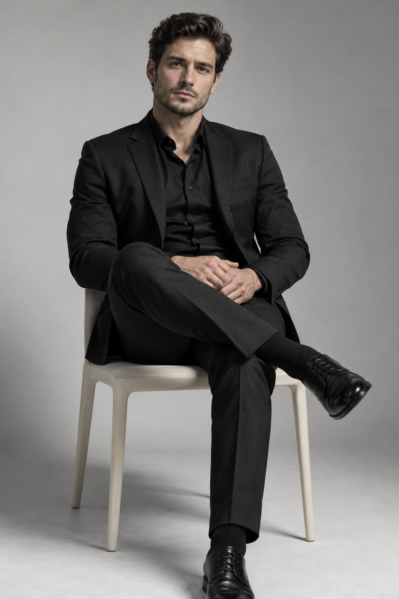
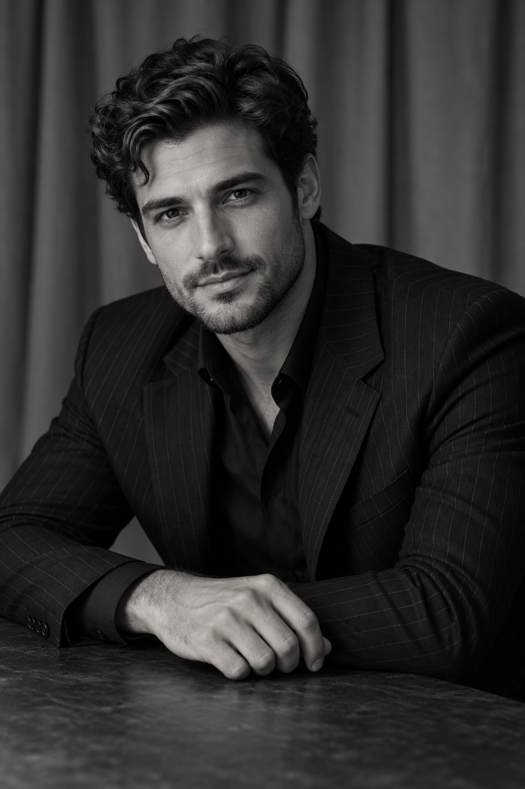
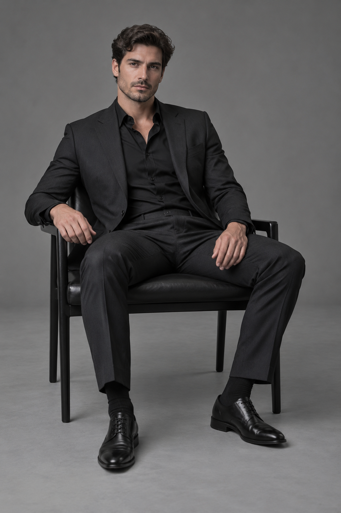
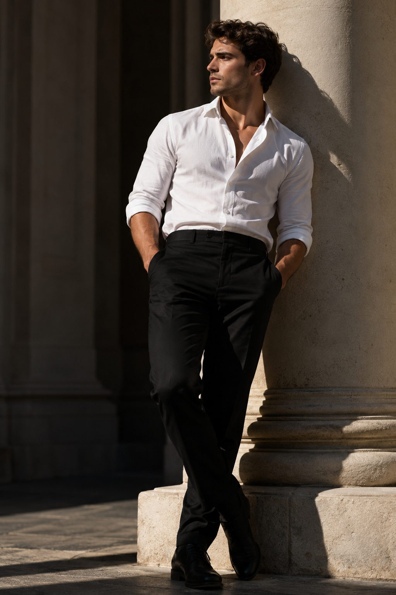
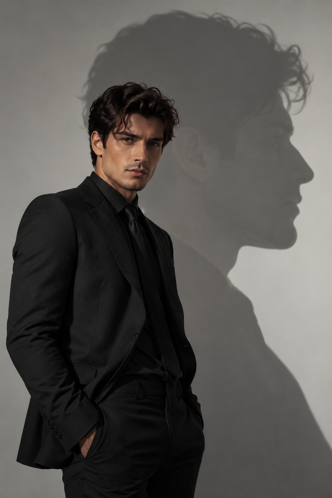

# 胡杨肖像 / Huyang Portrait

[中文](#中文) · [English](#english)

## 中文

胡杨肖像是一套以**男士写真**为主要方向的 Codex Skill。提供一张本人或已获授权的清晰照片，选一种摄影造型，再通过支持参考图片的 AI 图像工具制作肖像。原照提供人物身份，造型图提供摄影方向。

本仓库包含 Skill、造型说明与六张 AI 生成的虚构人物参考图；**不包含图像模型，也不是独立网站或在线相机**。它不保证每次生成的肖像都与本人相似。

### 六种造型

| 编号 | 造型与动作 |
| --- | --- |
| T01 | 黑西装坐姿 |
| T02 | 车旁回望 |
| T03 | 桌边肖像 |
| T04 | 单椅全身坐姿 |
| T05 | 白衬衫靠柱 |
| T06 | 双层侧脸投影 |

  
  
  
  
  
  

每款是一组造型与动作方向，可分别生成；本仓库不限制生成次数。示意人物只用于展示造型，不应替代使用者的身份。

### 安装和使用

1. 将本仓库下载或克隆到本地，把整个仓库目录复制到 Codex 技能目录 `~/.codex/skills/huyang-portrait/`，确保 `SKILL.md`、`references/` 和 `assets/` 保持原有相对位置。
2. 重新打开 Codex 或启动新的会话，确认有可接收参考图片的图像生成或编辑工具。该工具可能需要单独开通并产生费用，请以服务商实际条件为准。
3. 提供你本人或已获授权、五官清楚的单人照片，输入：

   > 使用 $huyang-portrait，按 T01 黑西装坐姿帮我制作肖像。先检查人物身份特征和辅助三视图，再生成成片。

4. 检查人物特征、手部、姿态和光线。如有偏差，可说明具体位置后要求调整。三视图中原照未显示的侧面是模型推演，不是真实侧面的测量。

### 照片与隐私

请只使用你有权处理的照片。使用外部图像工具时，原照及参考图可能被发送给服务商；请先了解实际使用服务的数据处理方式，并妥善保管本地输入和成片。请勿在公开 Issue 中提交个人照片、隐私信息或密钥。

### 许可和 Pro

本仓库按 [LICENSE](LICENSE) **仅供非商业使用**。商业用途需要先获得权利人单独授权。由于限制商用，本项目公开源码，但不符合开放源代码促进会（OSI）的开源许可证定义。

**Huyang Portrait Pro** 是完整版本，包含十二套造型、个人定装流程和批量选片工具。Pro 的购买和交付方式尚未上线，当前没有自动解锁服务。你可以通过 [Pro 版公开咨询入口](https://github.com/coder-MenSanPi/huyang-portrait/issues/new?title=Pro%20%E7%89%88%E5%92%A8%E8%AF%A2) 了解后续进展；该入口会创建公开 Issue，**不要提交个人照片、隐私或密钥**。

---

## English

Huyang Portrait is a Codex skill focused on **men’s portrait photography**. Supply a clear photo of yourself or a person whose permission you have, choose a photography direction, and use an AI image tool that accepts reference images. The source photo guides identity; the style reference guides the photographic direction.

This repository contains the skill, style guidance, and six AI-generated fictional-person reference images. **It does not include an image model, a standalone website, or a hosted camera.** A likeness in every generated portrait cannot be guaranteed.

### Six styles

| ID | Style and pose |
| --- | --- |
| T01 | Seated in a dark suit |
| T02 | Looking back beside a car |
| T03 | Portrait at a table |
| T04 | Full-length seated |
| T05 | White shirt by a column |
| T06 | Layered profile projection |

Each is one style-and-pose direction and can be generated separately; this repository does not impose a generation limit. The fictional reference subjects illustrate the styling and must not replace the identity in the source photo.

### Install and use

1. Download or clone this repository. Copy the whole repository directory to the Codex skills location `~/.codex/skills/huyang-portrait/`, keeping `SKILL.md`, `references/`, and `assets/` in their original relative locations.
2. Reopen Codex or start a new session, and ensure an image generation or editing tool that accepts reference images is available. That tool may require separate access and incur fees; check its provider’s terms.
3. Provide a clear single-person photo of yourself or a person whose permission you have, then ask:

   > Use $huyang-portrait to create a T01 seated dark-suit portrait. Check the subject’s visible identity features and the three-view identity reference before generating the final image.

4. Review the likeness, hands, pose, and lighting. Describe specific issues when requesting an adjustment. Views not visible in the source photo are model inferences, not measurements of the real person.

### Photos and privacy

Only use photos you are entitled to process. Depending on the image tool, the source and reference images may be sent to its provider. Review the service’s data practices first and protect your local inputs and outputs. Do not post personal photographs, private information, or credentials in public issues.

### License and Pro

The materials in this repository are licensed for **noncommercial use only**, subject to [LICENSE](LICENSE). Commercial use requires separate permission from the rights holder. Because commercial use is restricted, this project is source-available and does not meet the Open Source Initiative’s definition of an open-source license.

**Huyang Portrait Pro** is the full edition, includes twelve styles, a personalized styling workflow, and batch selection tools. Purchasing and delivery are not yet available, and there is no automatic unlock service. You can use the [public Pro inquiry form](https://github.com/coder-MenSanPi/huyang-portrait/issues/new?title=Pro%20%E7%89%88%E5%92%A8%E8%AF%A2) to ask about future availability. The form creates a public issue: **do not submit personal photos, private information, or credentials**.
